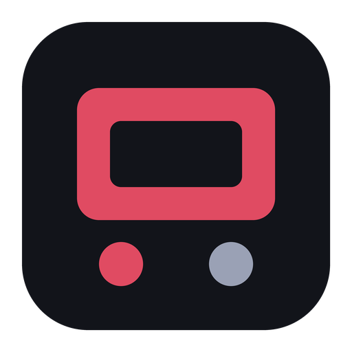
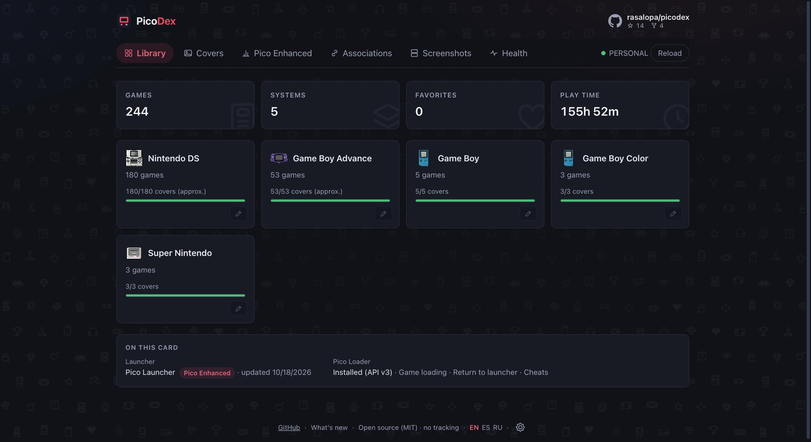
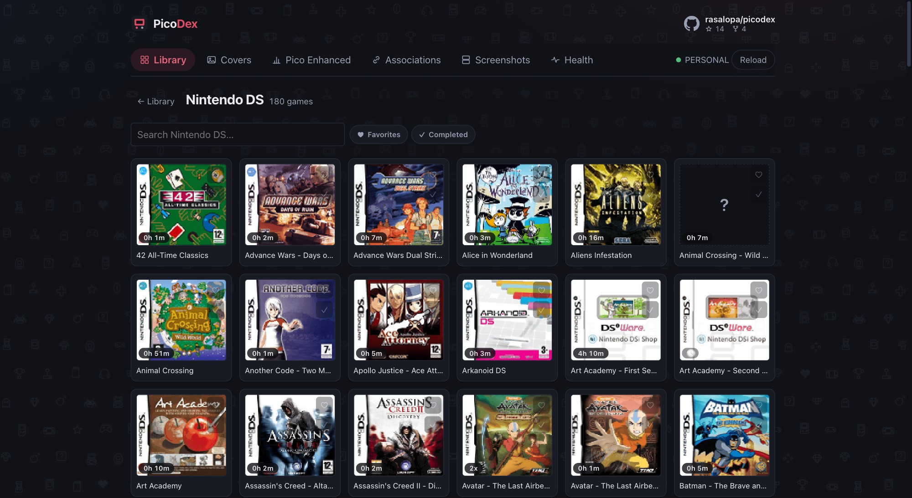
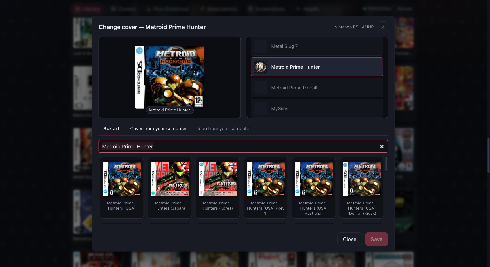
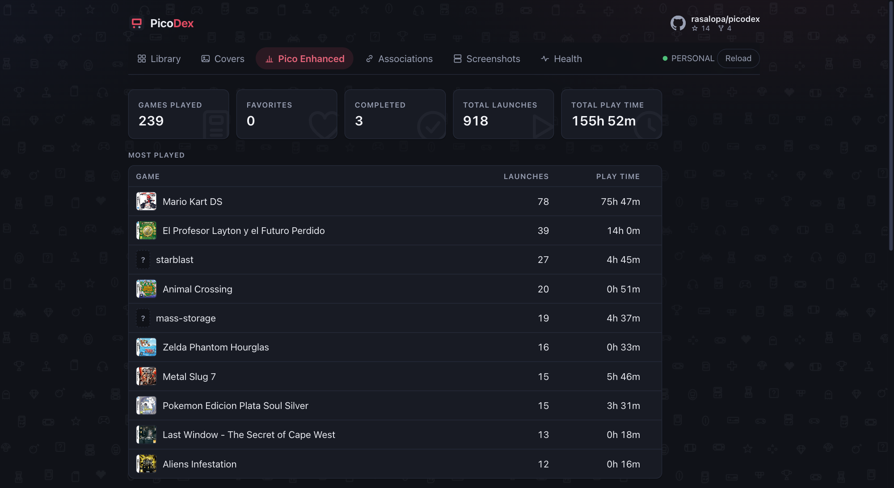
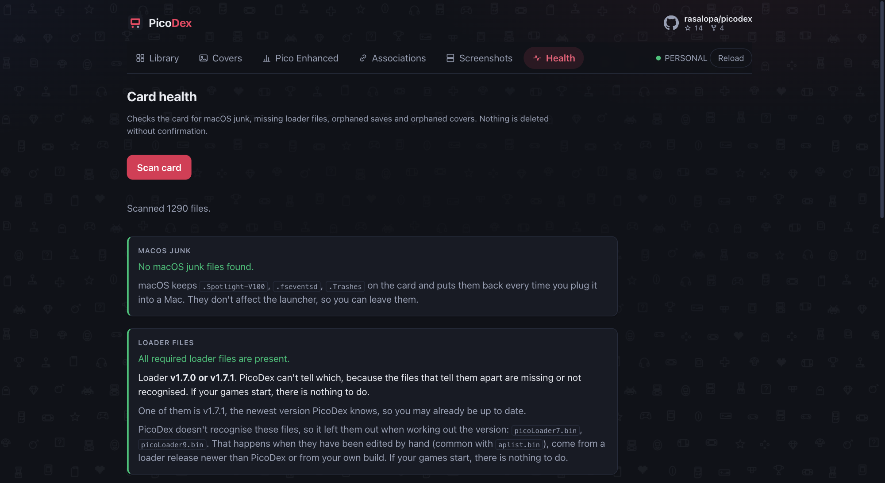
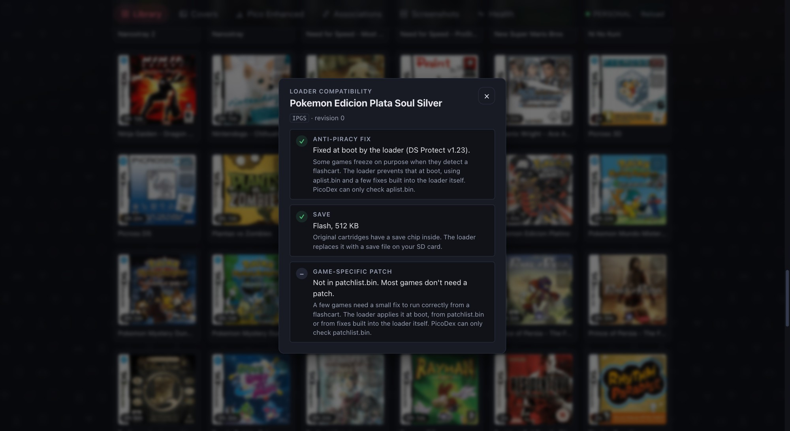
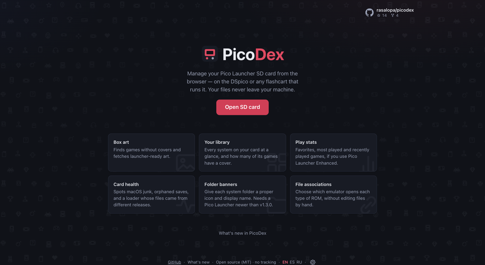
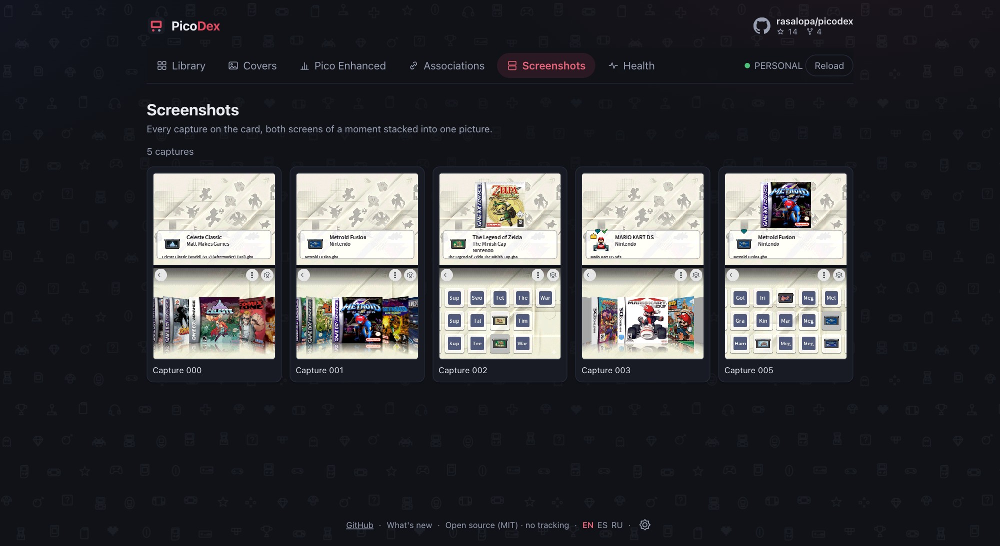

# PicoDex



[](https://github.com/rasalopa/picodex/actions/workflows/ci.yml)
[](https://rasalopa.github.io/picodex/)
[](https://github.com/rasalopa/picodex/releases)
[](LICENSE)

[English](README.md) | [Deutsch](README.de.md) | Italiano

> Gestisci la scheda SD di [Pico Launcher](https://github.com/LNH-team/pico-launcher) dal browser, sul [DSpico](https://github.com/LNH-team/dspico) o su qualsiasi flashcart che lo esegue. Copertine, organizzazione della libreria, preferiti e statistiche di gioco. Niente da installare, nessun backend, i tuoi file non lasciano mai il tuo computer.



<table>
  <tr>
    <td width="50%"></td>
    <td width="50%"></td>
  </tr>
  <tr>
    <td width="50%"></td>
    <td width="50%"></td>
  </tr>
  <tr>
    <td width="50%"></td>
    <td width="50%"></td>
  </tr>
  <tr>
    <td colspan="2"></td>
  </tr>
</table>

## Cosa fa

- 📂 **Apri la scheda SD** direttamente nel browser (File System Access API) e guarda tutta la libreria a colpo d'occhio: giochi per sistema, copertura delle copertine e, se usi [Pico Launcher Enhanced](https://github.com/rasalopa/pico-launcher-enhanced), preferiti, giochi completati e statistiche di gioco (che puoi anche correggere a mano).
- 🖼 **Gestione delle copertine**: trova i giochi senza box art, li confronta con i cataloghi di [libretro-thumbnails](https://github.com/libretro-thumbnails) (nomi No-Intro, con attenzione alla regione), mostra un'anteprima del risultato e scrive in `/_pico/covers/` BMP pronte per il launcher.
- 🎮 **Organizzazione della libreria**: trascina i file ROM sulla pagina e PicoDex riconosce il sistema, li mette sotto `Games/` e scarica le loro copertine.
- 📁 **Banner delle cartelle**: dai a ogni cartella di sistema un'icona e un nome visualizzato (`banner.bnr`), generati nel browser.
- 🔗 **Editor delle associazioni dei file**: collega ogni estensione ROM al suo emulatore senza modificare a mano `settings.json`.
- 🩺 **Controllo dello stato della scheda**: trova i file spazzatura di macOS, i file del loader mancanti e i salvataggi o le copertine orfani. Niente viene eliminato senza conferma. Identifica anche quale release di [Pico Loader](https://github.com/LNH-team/pico-loader) è installata sulla scheda, e segnala una scheda i cui file del loader provengono da release diverse.
- 📸 **Galleria degli screenshot**: ogni cattura che [Pico Launcher Enhanced](https://github.com/rasalopa/pico-launcher-enhanced) salva quando tieni premuto START, con i due schermi del DS uniti in una sola immagine. Puoi vederla a dimensione piena, salvarla come PNG o eliminarla dalla scheda.
- 🎮 **Compatibilità del loader per singolo gioco**: per qualsiasi gioco NDS, cosa farà il loader all'avvio (correzione anti-pirateria, tipo e dimensione del salvataggio, patch specifiche del gioco), confrontato con la revisione esatta della tua ROM.

Tutto gira nel browser. PicoDex non ha server, account né telemetria.

## Requisiti

- Un browser basato su Chromium (Chrome, Edge, Brave, Opera). Firefox e Safari non includono ancora la scrittura di cartelle della File System Access API.
- Una scheda SD con Pico Launcher: qualsiasi flashcart con una cartella `/_pico`, cioè il DSpico, oppure un R4, DSTT, Acekard, ecc. con Pico Launcher.

## Come si usa

**Usalo subito: https://rasalopa.github.io/picodex/**. Niente da installare.

Oppure eseguilo in locale:

```bash
git clone https://github.com/rasalopa/picodex.git
cd picodex
npm install
npm run dev
```

Apri l'URL indicato, fai clic su **Apri scheda SD** e scegli la tua SD collegata.

PicoDex si apre con il tema scuro. Il pulsante accanto alla lingua, nel piè di pagina, passa al tema
chiaro o segue quello del sistema.

## Sviluppo

```bash
npm run dev          # server di sviluppo
npm test             # test unitari (vitest)
npm run lint         # oxlint
npm run format:check # prettier
npm run build        # build di produzione
```

La logica interessante sta in [`src/lib/`](src/lib/), in TypeScript puro e senza dipendenze: lettura degli header NDS/GBA, codifica delle BMP nel formato del launcher, creazione di `banner.bnr`, abbinamento dei titoli delle box art e i formati `gamedata.json`/`settings.json` di Pico Launcher. L'app React è solo un sottile guscio intorno a questa logica.

Leggi [CONTRIBUTING.md](CONTRIBUTING.md) se vuoi dare una mano, e [CHANGELOG.md](CHANGELOG.md) per le
novità di ogni release.

## Ringraziamenti

- Il [team LNH](https://github.com/LNH-team) per il DSpico, il flashcart open source che rende tutto questo divertente, e per Pico Launcher.
- [libretro-thumbnails](https://github.com/libretro-thumbnails) per le raccolte di box art.

## Licenza

[MIT](LICENSE)
