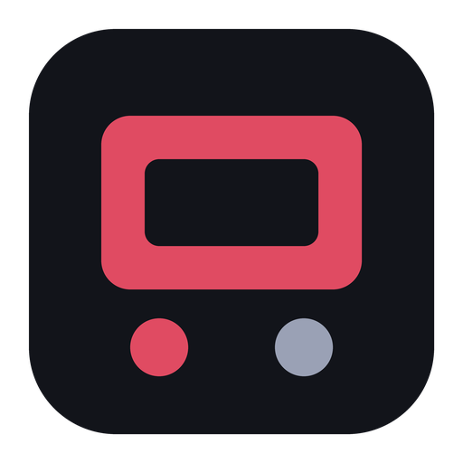
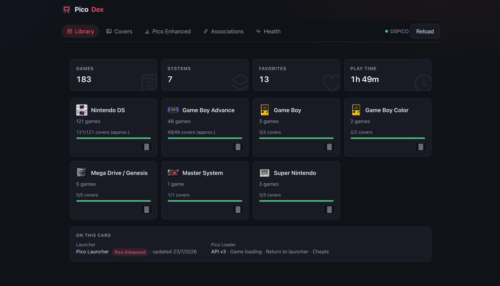
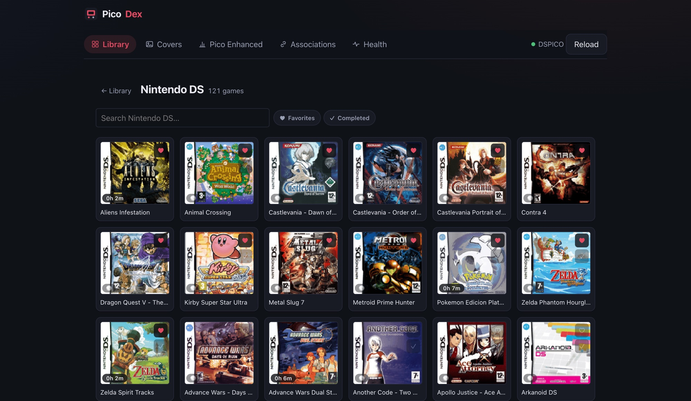
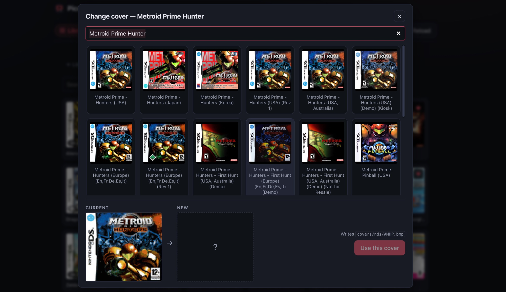
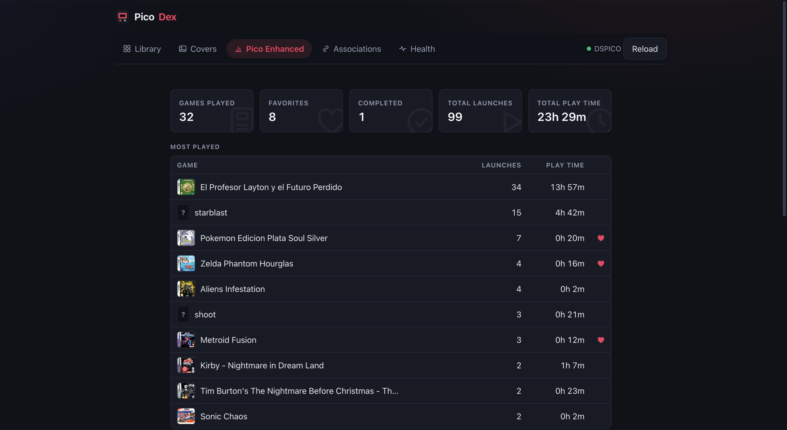
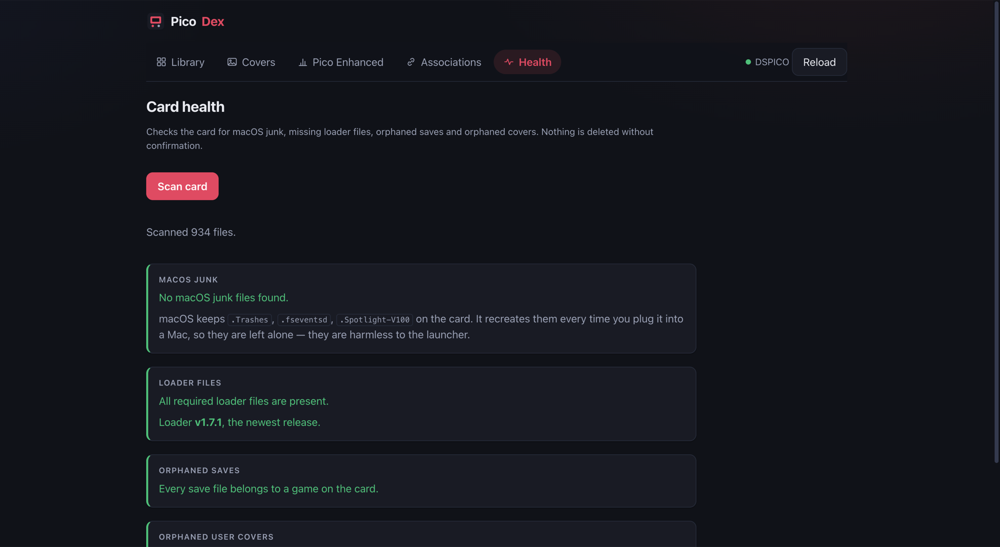
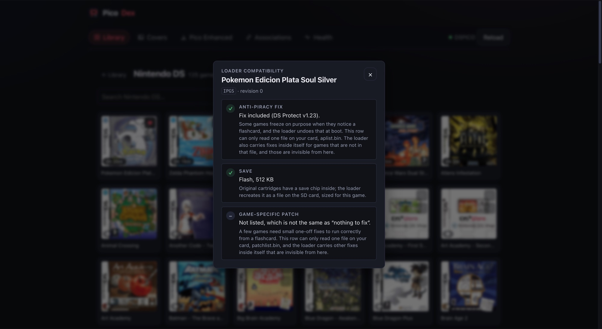
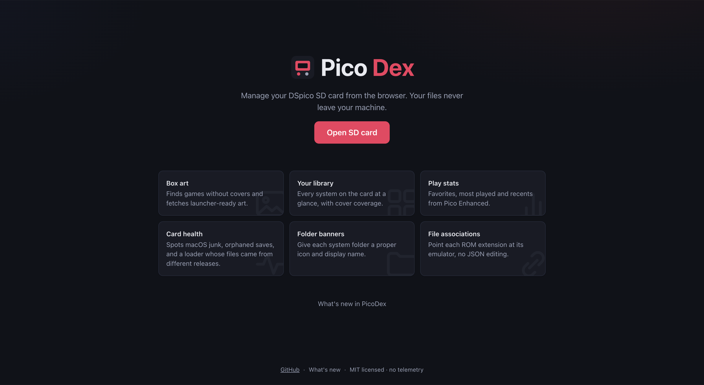
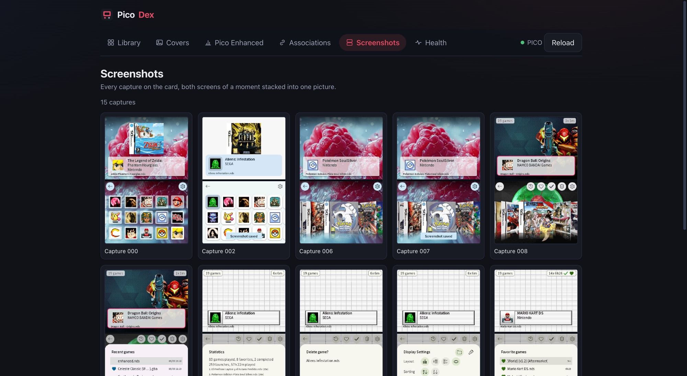

# PicoDex



[](https://github.com/rasalopa/picodex/actions/workflows/ci.yml)
[](https://rasalopa.github.io/picodex/)
[](https://github.com/rasalopa/picodex/releases)
[](LICENSE)

> Verwalte die SD-Karte deines [Pico Launcher](https://github.com/LNH-team/pico-launcher) direkt im Browser, auf dem [DSpico](https://github.com/LNH-team/dspico) oder jedem anderen Flashcart, auf dem er läuft. Cover, Bibliotheksorganisation, Favoriten und Spielstatistiken. Keine Installation, kein Backend, deine Dateien verlassen nie deinen Rechner.



<table>
  <tr>
    <td width="50%"></td>
    <td width="50%"></td>
  </tr>
  <tr>
    <td width="50%"></td>
    <td width="50%"></td>
  </tr>
  <tr>
    <td width="50%"></td>
    <td width="50%"></td>
  </tr>
  <tr>
    <td colspan="2"></td>
  </tr>
</table>

## Was es kann

- 📂 **SD-Karte öffnen**: direkt im Browser (File System Access API) und die gesamte Bibliothek auf einen Blick sehen: Spiele pro System, Cover-Abdeckung und, falls du [Pico Launcher Enhanced](https://github.com/rasalopa/pico-launcher-enhanced) benutzt, deine Favoriten, durchgespielten Spiele und Spielstatistiken (die du zur Korrektur auch von Hand bearbeiten kannst).
- 🖼 **Cover-Manager**: findet Spiele ohne Cover, gleicht sie mit den [libretro-thumbnails](https://github.com/libretro-thumbnails)-Katalogen ab (No-Intro-Benennung, regionsabhängig), zeigt eine Vorschau und schreibt launcher-fertige BMPs nach `/_pico/covers/`.
- 🎮 **Bibliotheksorganisation**: ROM-Dateien auf die Seite ziehen, PicoDex erkennt das System, legt sie unter `Games/` ab und holt die passenden Cover.
- 📁 **Ordner-Banner**: gib jedem Systemordner ein eigenes Icon und einen Anzeigenamen (`banner.bnr`), direkt im Browser erzeugt.
- 🔗 **Dateizuordnungs-Editor**: weise jeder ROM-Endung ihren Emulator zu, ohne `settings.json` von Hand zu bearbeiten.
- 🩺 **Kartencheck**: findet macOS-Müll­dateien, fehlende Loader-Dateien sowie verwaiste Spielstände oder Cover. Ohne Bestätigung wird nichts gelöscht. Außerdem erkennt er, welche [Pico-Loader](https://github.com/LNH-team/pico-loader)-Version auf deiner Karte läuft, und bemerkt, wenn Loader-Dateien auf einer Karte aus verschiedenen Versionen stammen.
- 📸 **Screenshot-Galerie**: jede Aufnahme, die [Pico Launcher Enhanced](https://github.com/rasalopa/pico-launcher-enhanced) speichert, wenn du START gedrückt hältst, mit beiden DS-Bildschirmen untereinander in einem Bild. Du kannst sie in voller Größe ansehen, als PNG speichern oder von der Karte löschen.
- 🎮 **Loader-Kompatibilität pro Spiel**: für jedes NDS-Spiel, was der Loader beim Start damit tut (Kopierschutz-Fix, Speichertyp und -größe, spielspezifische Patches), abgeglichen mit der exakten Revision deiner ROM.

Alles läuft clientseitig. PicoDex hat keinen Server, keine Accounts und keine Telemetrie.

## Voraussetzungen

- Ein Chromium-basierter Browser (Chrome, Edge, Brave, Opera). Firefox und Safari unterstützen die File System Access API mit Schreibzugriff auf Verzeichnisse noch nicht.
- Eine Pico-Launcher-SD-Karte: jedes Flashcart mit einem `/_pico`-Ordner: der DSpico oder ein R4, DSTT, Acekard usw., auf dem Pico Launcher läuft.

## Benutzung

**Direkt nutzen: https://rasalopa.github.io/picodex/**. Keine Installation nötig.

Oder lokal ausführen:

```bash
git clone https://github.com/rasalopa/picodex.git
cd picodex
npm install
npm run dev
```

Öffne die angezeigte URL, klicke auf **Open SD card** und wähle deine eingebundene SD-Karte aus.

PicoDex startet im dunklen Design. Die Schaltfläche neben der Sprachauswahl in der Fußzeile wechselt
zum hellen Design oder lässt es deinem System folgen.

## Entwicklung

```bash
npm run dev          # dev server
npm test             # unit tests (vitest)
npm run lint         # oxlint
npm run format:check # prettier
npm run build        # production build
```

Die interessante Logik liegt in [`src/lib/`](src/lib/) als reines, abhängigkeitsfreies TypeScript: Parsing von NDS-/GBA-Headern, Kodierung von BMPs im Launcher-Format, Erzeugung von `banner.bnr`, Titelabgleich für Box-Art sowie die Formate `gamedata.json`/`settings.json` des Pico Launcher. Die React-App ist nur eine dünne Hülle darüber.

Wenn du mithelfen möchtest, lies [CONTRIBUTING.md](CONTRIBUTING.md); was jede Version gebracht hat, steht in [CHANGELOG.md](CHANGELOG.md).

## Danksagungen

- Dem [LNH-Team](https://github.com/LNH-team) für den DSpico, das offene Flashcart, das das alles erst Spaß macht, und für den Pico Launcher.
- [libretro-thumbnails](https://github.com/libretro-thumbnails) für die Box-Art-Sammlungen.
- claude.ai, das mir die readme übersetzt hat (und nur die readme!)

## Lizenz

[MIT](LICENSE)
